<!--
  Nimantha Perera (Enigmuz) — DevSecOps Engineer, Cybersecurity Researcher, Security Automation & Agentic AI Security Engineer.
  Keywords: Nimantha Perera, Enigmuz, DevSecOps, RAG, Retrieval-Augmented Generation, Agentic AI Systems, Cybersecurity Engineer, Security Researcher, Threat Hunter, Detection Engineering,
  SOC Analyst, SOAR, SIEM, Security Automation, Agentic AI, AI Security, LLM Security, AI Red Teaming, MCP, Threat Intelligence,
  Dark Web Monitoring, Brand Protection, Anti-Phishing, Domain Squatting, Cloud Security, Secure CI/CD, Offensive Security.
-->

<div align="center">


<a href="https://github.com/enigmuz">
  
</a>

<p>
  
  <a href="https://github.com/enigmuz?tab=followers"></a>
  <a href="mailto:nimaishara@gmail.com"></a>
</p>



</div>

<br/>

## `> cat ./enigmuz.yaml`

```yaml
operator:
  name:        Nimantha Perera
  alias:       Enigmuz
  role:        Associate Engineer — DevSecOps
  class:       Builder | Defender | Researcher
  mission: >
    Building secure systems, researching vulnerabilities, and turning
    repetitive security work into autonomous, auditable pipelines —
    with AI agents that act only inside gated, authorized scopes.
  current_ops:
    - Agentic AI red-teaming & attack-surface management platform (MCP-orchestrated)
    - RAG systems that ground LLMs in security knowledge & telemetry
    - AI-assisted SOC triage with human-in-the-loop approval gates
    - Threat-intel, dark-web & brand-protection automation
  path:        Intern → SOC L1 → Senior SOC Analyst (Shift Lead) → DevSecOps
  education:   BSc (Hons) Computer Networks & Cyber Security — KIU (2026)
  motto:       "Automate the boring. Hunt the rest."
```

<br/>

## 🧬 Specialization Matrix

<table>
<tr>
<td width="50%" valign="top">

### 🤖 Agentic AI & RAG Systems
- **Agentic AI systems**: LLM agents orchestrated over **MCP** with **gated, scoped tools**
- AI-driven **red-teaming & attack-surface management** (authorized engagements)
- **AI-assisted SOC triage** with human-in-the-loop approval
- **RAG pipelines**: embeddings, vector search, grounded answers over security data
- AI-generated **CTI summaries** & IOC enrichment
- Prompt-injection & agent-safety thinking baked into design

</td>
<td width="50%" valign="top">

### ⚙️ Security Automation & SOAR
- Playbooks in **Shuffle**, **n8n** and **Ansible**
- SIEM ⇄ SOAR integrations for detection, enrichment & response
- Automated IOC pipelines (VirusTotal, AbuseIPDB, AlienVault OTX)
- Alert-to-ticket workflows and scheduled reporting bots
- Telegram / chat-ops threat notifications

</td>
</tr>
<tr>
<td width="50%" valign="top">

### 🛡️ DevSecOps & Secure CI/CD
- Security gates in the SDLC: SAST, dependency & container scanning
- Compliance checks as code in CI/CD pipelines
- Hardened **Docker** / **Kubernetes** workloads
- Secrets hygiene, least-privilege runners, signed releases
- Secure-by-design internal tooling for SOC operations

</td>
<td width="50%" valign="top">

### 🎯 Threat Hunting & Detection Engineering
- Hypothesis-driven hunts across SIEM & EDR telemetry
- Detection logic, use-case tuning, false-positive reduction
- IOC / TTP correlation mapped to **MITRE ATT&CK**
- Malware triage, containment & eradication support
- Incident response lead: investigation → recovery

</td>
</tr>
<tr>
<td width="50%" valign="top">

### 🕵️ Threat Intelligence & Digital Risk
- Dark-web & breach-forum monitoring concepts
- **Domain-squatting / phishing** detection with Visual AI
- Brand protection & automated **takedown** evidence packs
- CTI aggregation, categorisation and AI summarisation

</td>
<td width="50%" valign="top">

### ☁️ Cloud Security & Secure Engineering
- Cloud hardening and security controls on **AWS / Azure / GCP**
- Secure application development (Python, FastAPI, React, PHP)
- Vulnerability research & offensive-security tradecraft
- IoT security monitoring (ESP32-based sensing)

</td>
</tr>
</table>

<br/>

## 🛰️ Featured Operations

<table>
<tr>
<td width="50%" valign="top">

#### 🧠 Albino RedTeaming &nbsp;
Authorized **AI red-teaming & attack-surface-management** platform. An LLM agent bound over **MCP** plans and executes assessments (enumeration, vulnerability assessment) through **gated tools** — skills taught conversationally.
<br/>`FastAPI` `React` `Vite` `Tailwind` `MCP` `Agentic AI`

</td>
<td width="50%" valign="top">

#### 👁️ [PhantomEye](https://github.com/enigmuz/PhantomEye)
Final-year research: hybrid framework for detecting and mitigating **domain squatting** using **Visual AI** + fuzzy matching, with risk scoring and integrated abuse reporting for **domain takedown**.
<br/>`JavaScript` `Visual AI` `Fuzzy Matching` `Brand Protection`

</td>
</tr>
<tr>
<td width="50%" valign="top">

#### 📡 [Nexo Sentinel](https://github.com/enigmuz/nexo-sentinel-V1)
Automated **CTI platform**: collects from multiple intel sources, extracts & categorises **IOCs**, generates AI summaries and pushes actionable alerts to **Telegram** — cutting SOC analyst toil.
<br/>`Python` `CTI` `AI Summaries` `Telegram Bot`

</td>
<td width="50%" valign="top">

#### 🔮 [ThreatScry](https://github.com/enigmuz?tab=repositories&q=ThreatScry)
Web-based **IOC analysis** platform for bulk lookups via **VirusTotal, AbuseIPDB, AlienVault OTX** — CSV/PDF/TXT ingestion, history, filtering, live dashboards and exportable reports.
<br/>`Threat Intel` `IOC Enrichment` `Dashboards`

</td>
</tr>
<tr>
<td width="50%" valign="top">

#### 🧪 AI SOC Triage Lab
Self-hosted SOC lab wiring **Shuffle (SOAR)** + **Graylog (SIEM)** to an LLM for AI-assisted alert triage, with a **human-in-the-loop approval gate** before any response action.
<br/>`Shuffle` `Graylog` `LLM` `Docker` `HITL`

</td>
<td width="50%" valign="top">

#### 💊 [RxGuard](https://github.com/enigmuz?tab=repositories&q=RxGuard)
Secure multi-role **digital prescription** platform (doctor / pharmacist / patient) that blocks prescription shopping via **QR verification**, real-time dispensing controls and tamper-resistant validation.
<br/>`Secure App Dev` `RBAC` `QR Verification`

</td>
</tr>
<tr>
<td width="50%" valign="top">

#### 🔬 [LabElf](https://github.com/enigmuz?tab=repositories&q=LabElf)
**IoT lab-safety** monitor on **ESP32-S3** tracking hazardous gases, temperature, humidity & air quality, with **n8n** auto-reports emailed every 12 hours.
<br/>`ESP32-S3` `IoT` `n8n`

</td>
<td width="50%" valign="top">

#### 📇 [TapCard](https://github.com/enigmuz?tab=repositories&q=TapCard)
**NFC/RFID** digital business-card platform — tap-to-share profiles, real-time updates, analytics and QR codes.
<br/>`React (Vite)` `PHP` `MySQL` `NFC`

</td>
</tr>
<tr>
<td colspan="2" valign="top">

#### 🎟️ [Uptime-E](https://github.com/enigmuz?tab=repositories&q=Uptime)
**Event ticket management** system: event listings, ticket handling and attendee management.
<br/>`Secure App Dev` `Ticketing`

</td>
</tr>
</table>

<p align="center"><a href="https://github.com/enigmuz?tab=repositories"></a></p>

<br/>

## 🧰 Arsenal

<div align="center">

**Languages · Frameworks · Platforms**


<br/>


<br/><br/>

**SIEM · EDR · SOAR · Threat Intel**


<br/>


<br/>


</div>

<br/>

## 🌌 Skill Constellation

<div align="center">

</div>

<br/>

## 🏅 Certifications & Training

<div align="center">


<br/>


</div>

<br/>

## 📊 Telemetry

<div align="center">


</div>

<br/>

## 🐍 The Snake Hunts My Commits

<div align="center">
<picture>
  <source media="(prefers-color-scheme: dark)" srcset="https://raw.githubusercontent.com/enigmuz/enigmuz/output/github-snake-dark.svg"/>
  <source media="(prefers-color-scheme: light)" srcset="https://raw.githubusercontent.com/enigmuz/enigmuz/output/github-snake.svg"/>
  
</picture>
</div>

<br/>

## 📡 Open a Channel

<div align="center">

```diff
+ Open to: DevSecOps · Security Automation · Agentic AI Security · Threat Hunting · Detection Engineering
+ Ask me about: SOAR playbooks, AI-assisted SOC triage, CTI pipelines, secure CI/CD, brand protection
- Not available for: unauthorized testing of any kind. Scope first, always.
```

<a href="mailto:nimaishara@gmail.com"></a>
<a href="https://github.com/enigmuz"></a>

</div>

<details>
<summary><sub>🔎 <code>index --about</code></sub></summary>

<sub>
<b>Nimantha Perera</b> (GitHub: <b>Enigmuz</b> / <b>enigmuz</b>) is a <b>DevSecOps Engineer</b>, <b>Cybersecurity Researcher</b> and <b>Security Automation Engineer</b> who builds <b>Agentic AI systems</b>, <b>RAG systems</b> (retrieval-augmented generation), <b>Agentic AI security platforms</b>, <b>AI red-teaming</b> and <b>attack surface management</b> tools, <b>AI-assisted SOC triage</b>, <b>SOAR playbooks</b> (Shuffle, n8n, Ansible), <b>SIEM</b> integrations (Google Chronicle, Microsoft Sentinel, FortiSIEM, Graylog) and <b>EDR</b> investigations (CrowdStrike Falcon, Stellar Cyber).
Areas of work: <b>threat hunting</b>, <b>detection engineering</b>, <b>incident response</b>, <b>cyber threat intelligence (CTI)</b>, <b>IOC enrichment</b>, <b>dark web monitoring</b>, <b>brand protection</b>, <b>anti-phishing</b>, <b>domain squatting detection</b>, <b>secure CI/CD</b>, <b>cloud security</b> (AWS, Azure, GCP), <b>Kubernetes and Docker security</b>, <b>secure software development</b>, <b>vulnerability research</b> and <b>offensive security</b>.
Projects include PhantomEye, Nexo Sentinel, ThreatScry, RxGuard, LabElf, TapCard, Uptime-E (event ticket management) and Albino RedTeaming.
</sub>

</details>


